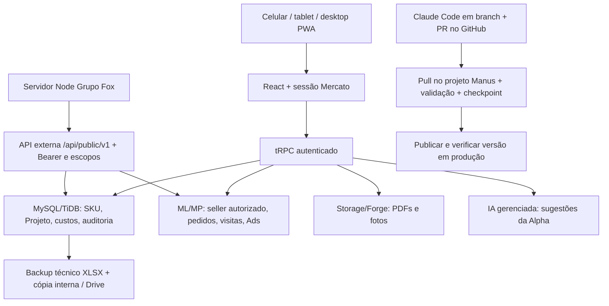

# Mercato — pacote de reprodução e manutenção pelo Claude Code

**Autoria: Manus e Fernando**  
**Data: 18/11/2026**

## Objetivo e limites

Este pacote descreve e preserva o estado atual acessível do Mercato para o Claude Code compreender o sistema, executar uma cópia isolada e fazer alterações no repositório existente. Não é uma reconstrução por memória: acompanha o código, os contratos, o schema real e um snapshot consistente dos dados. O snapshot não se atualiza depois de exportado.

**Claude Code não é um serviço de hospedagem.** Ele pode editar e executar o aplicativo em uma máquina/servidor com Node e banco. O domínio Manus, login da plataforma, armazenamento, LLM gerenciado, integrações OAuth e agendamentos não são transferidos automaticamente por copiar o código. Para manter todas as funções sem substituir essas dependências, a opção de menor risco é editar via GitHub e publicar o projeto Manus existente. Uma hospedagem independente exige provisionamento e validação próprios; não foi implantada nem certificada nesta entrega.

O pacote criptografado contém informações comerciais, pessoas cadastradas e credenciais de integrações. **Não o envie inteiro a um chat, não publique no GitHub e não deixe o cofre aberto para o agente.** Descriptografe localmente, proteja a pasta e dê ao Claude somente o código e a documentação necessários. A chave de descriptografia é entregue em arquivo separado.

## Conteúdo dos arquivos entregues

### Guia público para o agente (sem valores de segredos)

- Este manual, o prompt de edição/publicação e `CLAUDE.md`.
- `ARQUITETURA-E-FLUXOS.md` e os oito relatórios de módulos.
- `database-inventory.json`: schema/tabelas, contagens, hashes e tipos do snapshot, não seus registros.
- `database-server-metadata.json`: banco TiDB/MySQL e fuso SQL.
- `cofre-inventario-sem-valores.json`: variáveis presentes, limites e dependências, sem valores.
- `INTEGRIDADE.json`: arquivos, hashes, cobertura e versão do código.
- `descriptografar-pacote.py`: utilitário para abrir o arquivo autenticado AES-256-GCM localmente.

### Pacote criptografado

- `code/`: arquivos versionados do Mercato no checkpoint indicado em `INTEGRIDADE.json`, com testes, lockfile, configurações de build, migrations, referências e PDFs versionados. Não inclui `node_modules`, logs de runtime, arquivos `.env` ou o `.project-config.json` interno.
- `database/`: as **54 tabelas e 11.218 registros** exportados em uma transação de snapshot, incluindo tabelas vazias, IDs, SKUs, tombstones, reservas, logs e metadados de migrations. JSONL por tabela, DDL real e `mercato-snapshot.sql` gerado offline.
- `cofre-integracoes-confidencial.json`: cópia das configurações de integrações do usuário acessíveis no ambiente e das duas chaves Mercato originalmente entregues e ainda não marcadas revogadas no snapshot. Tokens OAuth e client secrets existentes também constam nas tabelas do banco. A validade pode mudar após a exportação.
- `assets/` e `assets-manifest.json`: cópias dos arquivos de storage identificados por referências reais/código, com SHA-256 e mapeamento para as chaves originais. Dez arquivos foram copiados. Seis referências não recuperadas eram exemplos documentais/testes sem correspondência no banco; nenhuma referência de banco identificada ficou nessa lista.
- `docs/`: cópia do manual, diagramas textuais, regras, inventários, documentação API e instruções.

Os valores de credenciais gerenciadas da plataforma (JWT, conexão do banco hospedado, Forge/LLM/storage, autenticação Manus e credenciais temporárias internas S3/Git) **não foram transferidos como segredos portáveis**. São identificados no inventário e devem ser configurados/autorizados adequadamente no destino. Isso é uma limitação explícita, não um cofre completo de toda a conta Manus.

## Identidade, versões e GitHub

- Repositório: `https://github.com/lfernandoaleixo-create/ml-market-analyzer`.
- Site existente: `https://mlmarketanl-kcmkt5tl.manus.space`.
- Tarefa Manus de referência: `8RcKsVxCkpJua1uLyK4kEL`. Confirme a associação antes de publicar.
- Loja desejada: Toujours, seller ML `3308178634`. O nome histórico LOJADOSRWU em documentos antigos refere-se ao mesmo ID; não usar a conta pessoal como substituta.
- `INTEGRIDADE.json` identifica HEAD e commit-base, arquivos copiados e hashes. Não confundir hash de um checkpoint, commit GitHub e a versão efetivamente publicada.
- A cópia de código preserva os arquivos da versão atual. O histórico completo de Git não é incluído nesta entrega; continua no GitHub autorizado. Não há URL de remote com token nem configuração interna de acesso S3 no pacote.
- A API comercial e suas chaves não concedem acesso ao GitHub ou à publicação Manus.

## Snapshot de dados

O banco foi lido entre **13:12:36 e 13:12:38 UTC de 18/11/2026** (**10:12 BRT**), em uma transação de snapshot consistente. Foram usados `SELECT`/`SHOW`, configuração de sessão e início/commit de leitura; o dialeto TiDB não aceitou a cláusula `READ ONLY` do MySQL na primeira tentativa. Nenhum `INSERT`, `UPDATE`, `DELETE`, DDL ou lock global foi executado no banco real. O SQL de restauração foi apenas gerado em arquivo, nunca executado.

Banco observado: `8.0.11-TiDB-v8.5.3-serverless`; sessão `SYSTEM`, sistema `UTC`. Datas SQL foram exportadas como strings UTC; inteiros grandes e decimais como strings, sem conversão destrutiva de precisão. Buffers em JSONL preservam sua estrutura tipo Buffer. O inventário traz contagens e SHA-256, e todos os JSONL foram parseados e conferidos contra os hashes.

Contagens importantes deste snapshot: 81 linhas SKU (inclui histórico/excluídas), 55 variações, 39 reservas de número de produto, 80 reservas de variante, 139 reservas de valor SKU e 89 eventos de auditoria. **Não use essas contagens como números comerciais futuros.** Atividade posterior da equipe não consta no pacote.

Tabelas de margem importada/custos estão vazias neste snapshot, assim como o catálogo/PDF Alpha quando indicado no inventário. Isso não é perda de dados durante o export: a contagem foi confirmada no snapshot. Vendas, pagamentos e informações ao vivo de ML/MP não são um arquivo histórico integral dentro do banco; são consultados na API e dependem de autorização/retenção da fonte. Memória/cache de processos, cookies do navegador, rascunhos localStorage de cada usuário e arquivos não referenciados no storage não são capturados por este snapshot.

## Reproduzir uma cópia isolada com segurança

Depois de extrair o ZIP do guia, no macOS/Linux, estando na pasta do guia e com os dois arquivos privados na pasta acima:

```bash
python3 -m venv .venv-abertura
.venv-abertura/bin/python -m pip install cryptography
.venv-abertura/bin/python descriptografar-pacote.py \
  ../mercato-estado-completo-2026-11-18.zip.enc \
  --key-file ../chave-descriptografia-mercato-confidencial.txt \
  --output ../mercato-descriptografado.zip
```

No Windows, use o Python do ambiente virtual em `.venv-abertura\Scripts\python.exe`. A abertura gera um ZIP privado e confere a autenticação AES-GCM; não executa código, não extrai arquivos e não restaura banco. Mantenha o arquivo da chave com acesso restrito e separado do arquivo criptografado.

1. Guarde o arquivo criptografado e a chave separadamente. Extraia o guia em uma pasta de trabalho e execute o utilitário de descriptografia, sem copiar a senha para prompt/log.
2. Confira hashes em `INTEGRIDADE.json`, depois extraia o ZIP descriptografado em uma pasta privada. Não coloque `database/` ou `cofre/` dentro de um repositório público.
3. Para manutenção do sistema existente, prefira clonar o GitHub autorizado e usar a branch/PR do prompt. Para uma reprodução offline, use `code/` como cópia de trabalho e nunca aponte para o banco hospedado de produção.
4. Instale Node22 e use o pnpm declarado em `package.json` (10.4.1). Execute `pnpm install --frozen-lockfile`. A instalação desse clone não foi testada nesta entrega: mudanças de registro/package manager podem exigir ajuste explícito, sem trocar dependências silenciosamente.
5. Comece com testes e fixtures sem credenciais reais: `pnpm check`, testes focados, `pnpm exec vitest run --exclude '**/*.live.test.ts'` e `pnpm build`. Não execute `.live.test.ts` nem scripts operacionais. O release funcional anterior possui evidência de 2.434 testes; esta entrega mudou somente instruções/documentação e realizou validações de export/arquivo, não uma nova certificação integral do runtime externo.
6. Para testar com os dados reais, provisione **banco MySQL/TiDB novo, vazio e isolado**, de acesso restrito. Um responsável deve revisar o DDL e importar `mercato-snapshot.sql`; se o destino não aceitar recursos TiDB, faça adaptação no DDL da cópia, nunca no banco original. O dump não contém `DROP`, mas **não deve ser aplicado em banco existente**. Não use `pnpm db:push` para restaurar ou reaplicar o histórico de migrations. A restauração em outro banco ainda não foi executada/testada.
7. Preserve IDs, valores, reservas, `isDeleted`, revisões, timestamps e logs. Não reindexe linhas nem gere SKUs novamente. Compare contagens, valores e hashes reexportados da cópia. Defina acesso ao banco novo em `DATABASE_URL`, use fuso UTC e uma chave de sessão própria; não reutilize JWT/credenciais de banco de produção.
8. Antes de iniciar a aplicação restaurada, desabilite agendas da cópia, tokens OAuth, envio de backups, integrações de escrita e chamadas reais. A tabela `ml_credentials` contém tokens; iniciar uma réplica com renovação automática pode rotacionar o mesmo refresh token da loja e atrapalhar a conexão original. Não reative sem plano e autorização.
9. Para ter todas as funções fora do Manus, configure/autorize login, storage, IA, domínios/callbacks OAuth ML/Google e infraestrutura de agendas. Não reimplemente à força ou diga que essas funções já funcionam somente porque o front abriu. Replicar auth/storage/LLM pode exigir adaptadores; documente o que falta.
10. Os caminhos `/manus-storage/...` precisam do storage original ou de um adaptador/mapeamento dos arquivos copiados. Não substitua silenciosamente URLs de dados reais. Imagens ML externas e links de documentos não recuperáveis continuam sujeitos ao provedor.

## Regras comerciais que nunca podem ser perdidas

SKUs são dados fundamentais. Não renumerar, reconstruir, reciclar automaticamente números excluídos ou aplicar ajustes em massa. Excluir não altera os códigos já criados. Reservas são históricas/append-only. Repetição manual deliberada é permitida, sem converter isso em duplicação automática. CAS/revisões, exclusão lógica, colaboração e decisões explícitas precisam ser preservados.

Um pedido de código não autoriza mudar SKUs reais. Para uma alteração de dados SKU, explicar exatamente os campos, perguntar “Tem certeza?” e exigir autorização explícita de Luis/Guilherme/Fernando/Bruno. Autorizações históricas não valem para novas alterações. Não corrigir problemas identificados na inspeção enquanto o objetivo é reproduzir o estado atual.

Mantenha cálculo local Alpha e seus testes, fonte oficial dos links, anúncios/campanhas intactos e identidade da Toujours. Líquido não é lucro; impostos retidos não representam todos os tributos. Não inventar zeros, taxa, rateio, completude ou histórico. `null`, `partial`, `stale`, `capped`, `asOf` e cobertura são parte do contrato.

## Fluxo resumido de informações



O detalhamento por módulo descreve o código observado, não um projeto idealizado. Ele registra limitações e rotas legadas preservadas; por exemplo, nem todos os routers internos travam a conta no seller esperado, e alguns módulos legados ainda têm normalizações/fallbacks inadequados. Essas divergências foram documentadas, não alteradas neste pacote.

## Cofre, serviços e segredos

O inventário distingue presença de valor e disponibilidade real do serviço. Uma variável configurada não prova autenticação válida; por exemplo, credenciais opcionais ML em ambiente podem diferir da conexão OAuth efetivamente usada no banco. Confiar em `/users/me` e no seller, não em um rótulo de “conectado”.

O arquivo de código original pode conter uma credencial literal legada de desbloqueio SKU em router. **Ela não foi divulgada no manual nem removida do sistema para esta cópia exata**; por isso todo o código original está no pacote confidencial, não em um ZIP público aberto. Não a imprimir, reutilizar como nova autorização ou incluir em relatórios. Sua eventual remoção exige mudança específica e testada.

A conta GitHub, conta Manus, segredos de APIs, banco gerenciado e credenciais de produção são acessos distintos. O cofre da máquina do Claude deve ser configurado pelo usuário fora do Git/chat. Tokens expiram, são revogados e rotacionam; um backup de token não garante acesso futuro. Credenciais da plataforma Manus, histórico completo da conta, domínio, cookies e autorizações administrativas não são exportáveis por este pacote.

## Fontes e verificações

Arquivos reais deste repositório e oito relatórios de inspeção estática são a referência de funcionamento. Preservação das versões e contratos anteriores está em `todo.md` e documentação da API. Fontes oficiais de permissões, integração Chrome e publicação: referências do prompt.

O pacote é uma cópia técnica feita nesta sessão, **não é o Task Data Backup oficial do Manus**. Para um backup completo nativo de conta/serviço/hospedagem, utilize o export oficial da plataforma quando aplicável; o código isolado não substitui database/files/secrets/serviços gerenciados. Não foi inferido nenhum impacto de mudança de serviço nesta conta.
